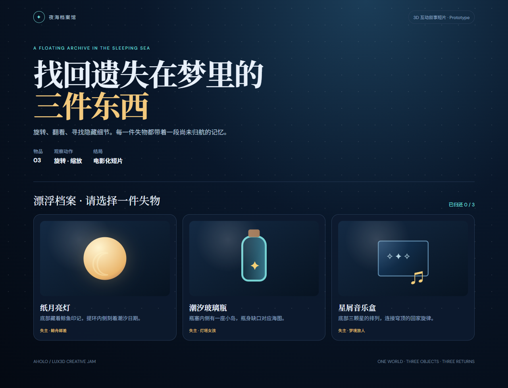
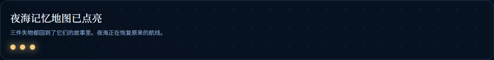
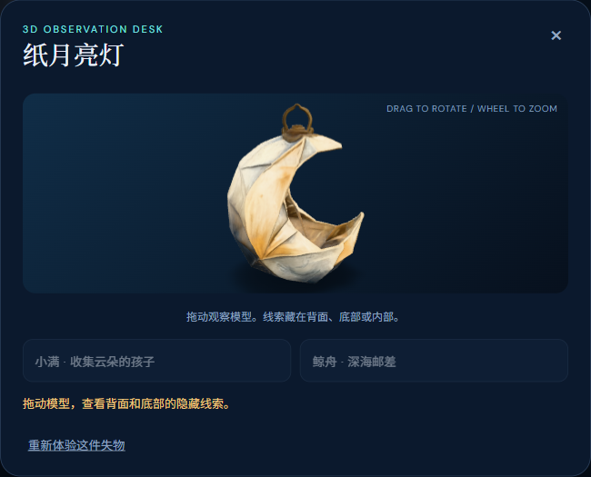
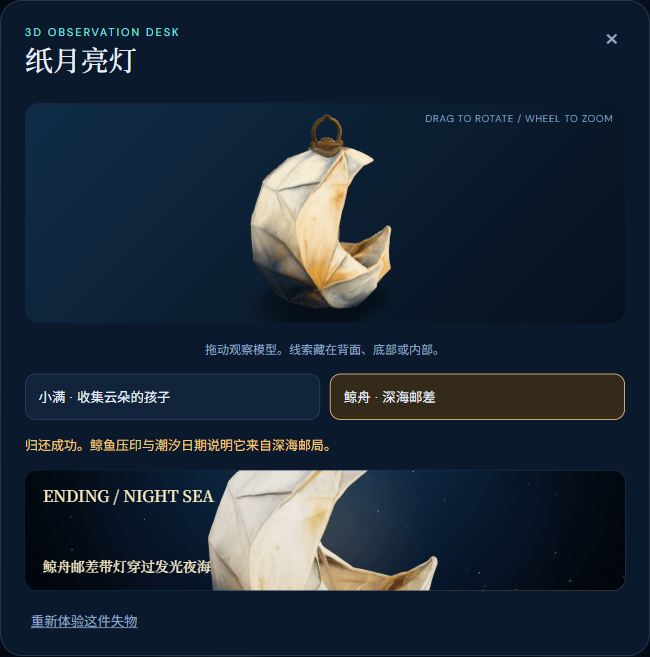
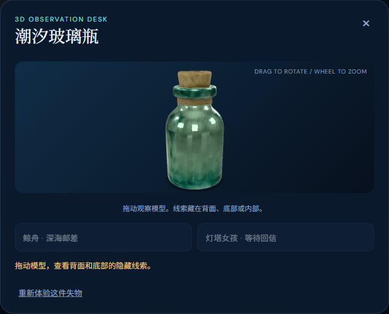
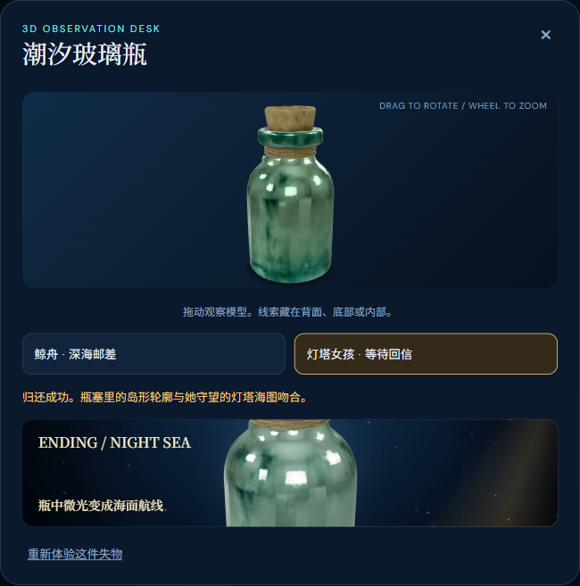
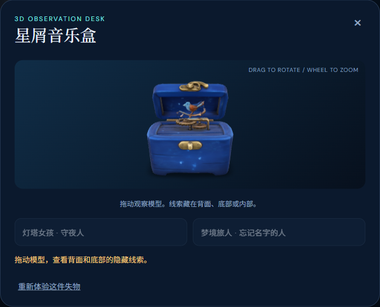
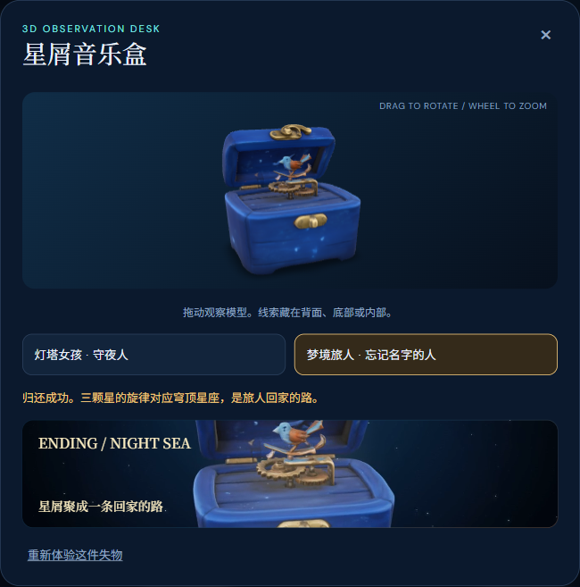

# 梦境失物招领：夜海档案馆

> Aholo 全球 3D AI 黑客松参赛作品 · 3D 互动叙事短片

**在线 Demo**：`https://rinkobe.github.io/night-sea-archive/`
**演示视频**：`docs/assets/demo-walkthrough.mp4`
**源代码**：`https://github.com/RinKobe/night-sea-archive`

---

## 一句话概念

玩家在漂浮于夜海上的梦境档案馆中，翻看三件由 Aholo Lux3D 生成的遗失物，通过旋转、缩放和寻找藏在背面、底部、内部的细节，推断它们各自属于谁。归还成功后，播放由同一件 GLB 本地渲染的电影化结局短片。

## 1. 项目概述

《梦境失物招领：夜海档案馆》是一款运行在浏览器中的 3D 互动叙事短片。作品把“3D 模型”从展示对象变成叙事媒介：线索不在文字里，而在物体真实的背面、底部和内部。玩家必须真正观察三维形体，才能推进故事。

作品参加 Aholo 全球 3D AI 黑客松。核心 3D 资产全部由 **Aholo Lux3D** 生成；结局短片由同一份 GLB 在本地渲染，保证网页、模型与视频三者的轮廓、配色和线索标记一致。



## 2. 玩法流程

1. 进入“夜海档案馆”，看到三件漂浮的失物。
2. 点击物品，进入 3D 观察模式。
3. 拖动旋转、滚轮缩放，查看正面、背面、底部或内部。
4. 找到隐藏线索，例如鲸鱼印记、潮汐刻度或残缺旋律。
5. 从两位候选失主中选择一位，查看判断依据。
6. 归还成功，播放该物品的电影化结局短片。
7. 三件物品全部归还后，点亮“夜海记忆地图”。



## 3. 三件失物

### 纸月亮灯

- **外观**：暖象牙色手工纸灯，月牙轮廓，黄铜提环，内部有微弱暖光。
- **隐藏线索**：灯底有鲸鱼压印，提环内侧刻着潮汐日期。
- **失主**：负责把梦送回海面的鲸舟邮差。
- **结局**：鲸舟邮差提着月亮灯穿过发光的夜海，把灯挂回远处的梦岛。

| 3D 观察 | 电影化结局 |
| --- | --- |
|  |  |

### 潮汐玻璃瓶

- **外观**：蓝绿色半透明漂流瓶，瓶中悬浮一小片会发光的海草。
- **隐藏线索**：瓶塞内侧藏有一座小岛的轮廓，瓶身缺口与海图上的缺口吻合。
- **失主**：一直等待回信的灯塔女孩。
- **结局**：瓶中的微光变成海面航线，灯塔重新亮起。

| 3D 观察 | 电影化结局 |
| --- | --- |
|  |  |

### 星屑音乐盒

- **外观**：深蓝木质音乐盒，表面有星屑纹理，打开后出现一只旋转的小鸟。
- **隐藏线索**：底部有三颗星的排列，内部旋律对应档案馆穹顶的星座。
- **失主**：忘记自己名字的梦境旅人。
- **结局**：音乐盒旋律让散落的星屑聚合成一条回家的路。

| 3D 观察 | 电影化结局 |
| --- | --- |
|  |  |

## 4. Aholo Lux3D 使用证明

三件核心资产均由 Aholo Lux3D 生成，任务记录保存在 `aholo-lux3d-task.json`。

| 资产 | 生成方式 | Lux3D 任务 ID | 报价积分 | 状态 |
| --- | --- | --- | --- | --- |
| 纸月亮灯 | 文生 3D | 8325054 | 13 | 成功 |
| 潮汐玻璃瓶 | 文生 3D | 8326675 | — | 成功 |
| 星屑音乐盒 | 文生 3D | 8326700 | — | 成功 |

账户积分快照：**3587 credits**（生成后记录于任务文件）。

### 过程证据：失败尝试

纸月亮灯第一轮使用 `stylized cinematic` 风格时被平台拒绝：

```json
"failedAttempt": {
  "style": "stylized cinematic",
  "reason": "unsupported style",
  "status": "rejected"
}
```

随后改用受支持风格重新生成，得到最终 GLB。该记录保留在 `aholo-lux3d-task.json` 中，作为“提示词迭代 → 资产结果”的过程证据。

### 生成提示词

**纸月亮灯**

```text
stylized cinematic 3D prop for an interactive web story, a handmade ivory paper moon lantern shaped like a crescent moon, warm inner glow, delicate folded paper texture, small brass handle, a subtle embossed whale emblem on the underside, readable silhouette from every angle, clean materials, no text, no background, game-ready GLB asset
```

**潮汐玻璃瓶**

```text
stylized cinematic 3D prop, a small sea-green translucent glass message bottle from a dream ocean, rounded worn edges, cork stopper, a tiny glowing piece of seaweed floating inside, a hidden island-shaped mark under the stopper, readable silhouette, clean game-ready materials, no text, no background, GLB asset
```

**星屑音乐盒**

```text
stylized cinematic 3D prop, a small deep-blue wooden music box covered with subtle star-dust patterns, hinged lid, tiny rotating bird mechanism visible inside, three-star constellation mark on the bottom, soft magical reflections, readable silhouette, clean game-ready materials, no text, no background, GLB asset
```

## 5. 技术实现

- 原生 HTML / CSS / JavaScript，无需构建步骤
- `model-viewer` 加载 GLB，支持旋转、缩放和触摸
- 拖动或滚轮触发线索发现，随后解锁失主选择
- `localStorage` 保存已归还物品和地图进度
- 结局使用 HTML5 `<video>` 播放，加载失败时保留 CSS 降级画面
- 全部资源本地托管，打开网页即可体验

## 6. 结局短片：同一 GLB 的本地电影化渲染

Aholo 黑客松中 **LuxReal 为可选工具**，且比赛仅发放 Aholo Lux3D 积分，未包含 LuxReal 积分。因此本项目采用本地渲染管线完成结局镜头，既保证与网页模型一致，也不额外消耗视频平台积分。

管线：

```text
render/ending.html  → model-viewer 加载 GLB + 8 秒电影化运镜 + 夜海粒子 + 字幕
render/record.mjs   → Playwright 驱动 Chrome 录制 1280×720 画面
ffmpeg              → 转 H.264 MP4，30fps，8 秒
```

输出：

- `docs/assets/paper-moon-ending.mp4`
- `docs/assets/tide-glass-bottle-ending.mp4`
- `docs/assets/stardust-music-box-ending.mp4`

三段视频均为 1280×720 / 30fps / 8 秒，主体、配色和线索标记与网页中的 GLB 完全一致。

## 7. 完成度与可运行性

| 项目 | 状态 |
| --- | --- |
| 三件 Lux3D 资产 | ✅ 全部生成并加载 |
| 3D 旋转 / 缩放观察 | ✅ |
| 隐藏线索与失主判断 | ✅ 三件物品各一轮 |
| 三段结局短片 | ✅ 本地渲染，自动播放 |
| 记忆地图与进度保存 | ✅ localStorage |
| 80 秒完整演示录屏 | ✅ `docs/assets/demo-walkthrough.mp4` |
| 端到端自动化测试 | ✅ 三件物品均验证 video readyState=4 |

## 8. 评审亮点

1. **3D 直接承担玩法**：线索藏在背面、底部和内部，截图和 2D 图片无法替代交互观察。
2. **跨媒介一致性**：同一份 GLB 同时出现在网页和结局短片中，验证了从 AI 生成到可运行作品的完整链路。
3. **完整闭环**：开始 → 观察 → 判断 → 归还 → 结局 → 地图，体验短而完整，评委可在几十秒内理解价值。
4. **工程可复现**：资产任务记录、提示词、渲染脚本、演示录屏全部保留。

## 9. 提交材料

- 在线 Demo：`https://rinkobe.github.io/night-sea-archive/`
- 演示视频：`docs/assets/demo-walkthrough.mp4`
- 项目报告：本文件 / `report/report.pdf`
- 源代码：`https://github.com/RinKobe/night-sea-archive`
- 三件 GLB：`docs/assets/*.glb`
- 三段结局短片：`docs/assets/*-ending.mp4`
- 过程证据：`aholo-lux3d-task.json`、`screenshots/`、`render/`

---

*本作品为 Aholo 全球 3D AI 黑客松参赛项目。核心 3D 内容由 Aholo Lux3D 生成；结局短片由同一 GLB 本地渲染。*
